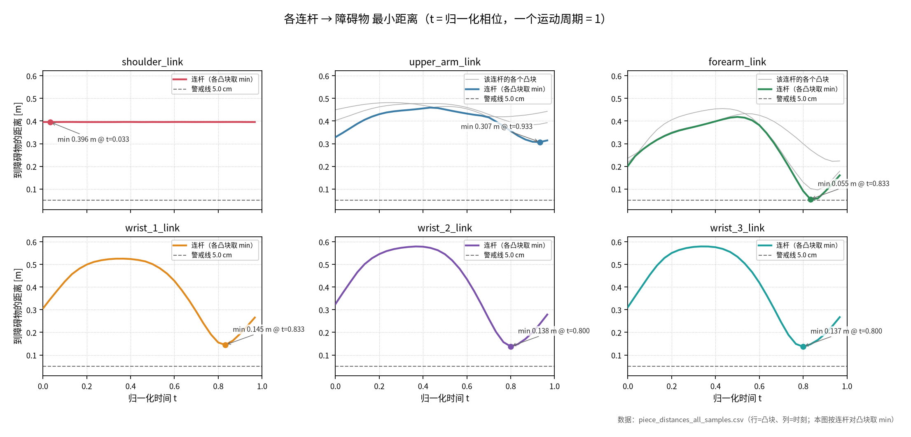

# UR5 + 铣削电主轴 凸块距离计算（V-HACD）

用 V-HACD 把 UR5（末端默认是**铣削电主轴 + Ø10 立铣刀**）的 URDF **碰撞网格**拆成若干凸块，
让机械臂做正弦运动，逐采样点计算 **每个凸块 / 每个连杆到场景中障碍物的最小距离**，并导出 CSV / NPZ。

> 末端执行器全是 fixed 关节，不参与摆动；想换回原来的 Robotiq 2F-140 夹爪只要
> `--urdf URDF/ur5_robotiq_140.urdf`（两种末端的对照见 §13）。

> 只看"机器人 ↔ 障碍物"的距离，**不计算机器人本体各连杆之间的距离**
> （那些碰撞体在关节/夹爪处本来就互相重叠，会算出负距离，没有物理意义）。

---

## 1. 目录结构

```
VHACD/
├── link_piece_distance_matrix.py    # 主程序（本文档描述的就是它）
├── plot_link_distances.py           # 画图：每根手臂连杆的距离-时间 六宫格（§12）
├── view_convex_trajectory.py        # 凸包运动可视化（§11）
├── make_spindle_meshes.py           # 生成电主轴 + 铣刀的 STL（§13）
├── test_vhacd.py                    # 小工具：在 GUI 里加载 URDF、开线框，肉眼检查碰撞体
├── README.md
├── URDF/
│   ├── ur5_spindle.urdf             # 默认：UR5 + 铣削电主轴 + Ø10 铣刀
│   └── ur5_robotiq_140.urdf         # 备用：UR5 + Robotiq 2F-140 夹爪（--urdf 指定）
├── meshes/
│   ├── ur5/{collision,visual}/      # URDF 引用的 UR5 网格
│   ├── spindle/{collision,visual}/  # 电主轴：转接法兰 / 机身 / 前座 / ER20 螺母 / 铣刀
│   └── robotiq_140/{collision,visual}/
├── distance_matrix_out/             # 运行后自动生成（默认输出目录）
│   ├── cache/                       # 凸分解缓存（V-HACD 结果 + 每块凸包 OBJ）
│   ├── pieces.csv
│   ├── piece_distance_to_obstacle.csv
│   ├── link_distance_to_obstacle.csv
│   ├── piece_distances_all_samples.csv
│   ├── distances.npz
│   └── link_distances_over_time.png   # plot_link_distances.py 画的六宫格（§12）
└── distance_matrix_out_robotiq/     # 换末端之前的夹爪结果（备份，CSV / NPZ 同上）
```

`--out-dir` 可以指定到别处；把 `distance_matrix_out/` 删掉也没关系，下次运行会重新生成
（只是要重跑一次 V-HACD）。

---

## 2. 运行环境与用法

依赖：python3 + pybullet + numpy + scipy。本机使用的解释器为
`/home/thor/miniconda3/envs/ur5_sim/bin/python`。

```bash
python link_piece_distance_matrix.py                       # 无窗口，30 个采样点（电主轴 + 铣刀）
python link_piece_distance_matrix.py --samples 60 --amp 0.5
python link_piece_distance_matrix.py --gui                 # 开窗口看机械臂运动
python link_piece_distance_matrix.py --gui --opengl2 --hold
python link_piece_distance_matrix.py --recompute           # 忽略缓存重跑 V-HACD
python link_piece_distance_matrix.py --obstacle-pos 0.4,-0.25,0.2 --obstacle-size 0.1,0.1,0.2
python link_piece_distance_matrix.py --no-ground --max-distance 0.5
python link_piece_distance_matrix.py \
    --urdf URDF/ur5_robotiq_140.urdf --gripper closed \
    --out-dir /tmp/dm_gripper                             # 换回夹爪（夹爪才会用到 --gripper）
```

---

## 3. 程序逻辑

`main()` 分 7 步：

### (1) 解析 URDF
`parse_urdf()` 用 `xml.etree` 自己读 URDF，拿到每个 link 的 `<collision>` 元素
（`mesh` 的路径 + scale + origin，或 `box` 的尺寸），以及 joint 的
`parent/child/type/axis/mimic`。不用 PyBullet 的解析结果，是为了拿到**原始网格文件**
（后面要自己切凸块）。

### (2) 凸分解 —— `build_pieces()`
每个 link 的每个 collision 元素变成 1 个或多个**凸块**（每块写成 link 坐标系下的 OBJ）：

| 情况 | 处理 |
|---|---|
| `<box>`（例如夹爪指垫） | 直接展开 8 个角点 → 1 个凸块 |
| 已经凸的网格（体积 / 凸包体积 ≥ `--convex-ratio`，默认 0.99） | 直接取其凸包（Robotiq 的夹爪件基本都是这种） |
| 凹网格（UR5 的 base/shoulder/upperarm/forearm/wrist） | 调 `p.vhacd()` 切成多块，每块再取凸包 |

V-HACD 结果缓存在 `<out-dir>/cache/`，缓存文件名由
`网格名 + concavity + resolution + depth + max_vertices_per_ch` 组成，
换参数会自动重算，不换参数直接复用；`--recompute` 强制重算。
缓存里的 `*_vhacd.log` 只是 V-HACD 打印的点云日志，删掉无影响。

### (3) 每个凸块建一个静态刚体 —— `create_piece_bodies()`
每块一个 `GEOM_MESH` + `mass=0` + **`collisionMargin=0`**（关键：Bullet 默认 1 mm margin
会让每对距离少算 1~2 mm）。这些刚体不参与动力学，只当"测距用几何体"，
每帧被搬到对应连杆的世界位姿上。

### (4) 规则运动 —— `Motion`
```
q_k(t) = home_k + amp * sin(2*pi*freq*t + k*phase_step)     t = s / samples, s = 0..samples-1
```
* `home` 默认 `0,-1.2,1.2,-1.57,-1.57,0`，`amp=0.35 rad`，`freq=1`，
  `phase_step=60°`（相邻关节的相位差，让机械臂做出"拧"的动作而不是整体同步摆）；
* 夹爪（只有夹爪模型才有）：`--gripper cycle`（`finger_joint` 在上下限之间做正弦，其余
  mimic 关节按 `multiplier/offset` 联动）、`open`、`closed`。电主轴模型的末端全是 fixed
  关节，不参与摆动，控制台会说明 `--gripper` 不生效。

### (5) 每个采样点摆位 —— `apply_config()`
```
resetJointState(robot, j, q)                            # 设关节角
getLinkState(robot, i, computeForwardKinematics=True)   # FK 得到连杆世界位姿
resetBasePositionAndOrientation(piece_body, pos, orn)   # 把该连杆的凸块搬到同一世界位姿
```
全程**不调用 `stepSimulation()`**：不需要动力学，只要几何位姿。30 个采样点约 0.07 s。

### (6) 测距 —— `distance_to_obstacle()`
对每个"机器人凸块 × 障碍物凸块"调用一次
`p.getClosestPoints(piece_body, obstacle_body, max_distance)`，取所有接触点里最小的
`contactDistance`：

* 障碍物是一个 `<box>` 刚体（凸的，算 1 个凸块，同样 `collisionMargin=0`）；
* 凸-凸距离由 GJK/EPA 给出：分离时为正，贴合时约 0；
* 若真的穿透，Bullet 会返回**负的穿透深度** → 统一**截断为 0** 并计数，
  最后打印 `[warn] 累计 N 次穿透判定已截断为 0`；
* 距离超过 `--max-distance`（默认 5 m）的记为 `--max-distance`（语义是"够远"）。

随后按连杆聚合：`d_link = min(该连杆所有凸块的距离)`。

### (7) 输出
写 4 个 CSV + 1 个 NPZ，并在控制台打印每个连杆的距离表（见第 5、7 节）。

---

## 4. 为什么这样设计（几个容易踩的坑）

| 设计 | 原因 |
|---|---|
| 只测"机器人 ↔ 障碍物" | 机器人自身各连杆的碰撞体在关节/夹爪处**本来就是互相插入**的（Robotiq 简化几何重叠约 30 mm），两两测距会得到一堆负值，掩盖真正有意义的最近距离 |
| `collisionMargin = 0` | Bullet 默认每个形状有 1 mm margin，距离会偏小 1~2 mm |
| 静态刚体 + 手动摆位 | 不需要动力学/碰撞响应，测距只要几何位姿；比 `stepSimulation` 快且完全可重复 |
| 凸块 = 凸包 | 凸-凸距离由 GJK/EPA 精确求解，没有"点云最近点"之类的近似误差 |
| 距离非负 | 距离在语义上不应为负；负值只可能来自真实穿透，截断为 0 并告警 |
| GUI 断开保护 | `--gui` 下按 ESC / 点窗口关闭会让 Bullet 直接退出渲染服务，程序会捕获 `pybullet.error`、保留已算完的采样点并正常退出（退出码 0） |

**精度参考**：把本程序的"凸块 ↔ 障碍物"结果，与直接用 PyBullet 对 URDF 原始连杆碰撞体
测距的结果对比，夹爪模型（19 个连杆）的偏差 **平均 0.88 mm、最大 1.54 mm**（来源：1 mm collision
margin + V-HACD 近似）。想更精确就调小 `--vhacd-concavity`（更慢）或提高凸包阈值。

---

## 5. 控制台输出长什么样

```
====================================================================================================
URDF     : /home/thor/Desktop/jsm/VHACD/URDF/ur5_spindle.urdf
PyBullet : 202010061  模式: DIRECT

[凸分解] 13 个 collision 元素 -> 17 个凸块
  base_link                  base.stl                                 V-HACD 1 pcs (ratio=0.850)
  upper_arm_link             upperarm.stl                             V-HACD 3 pcs (ratio=0.685)
  forearm_link               forearm.stl                              V-HACD 3 pcs (ratio=0.645)
  ee_link                    box [0.01, 0.01, 0.01]                   1 pcs (box)
  spindle_mount_link         spindle_mount.stl                        already convex (ratio=1.000)
  spindle_link               spindle_body.stl                         already convex (ratio=1.000)
  spindle_link               spindle_nose.stl                         already convex (ratio=1.000)
  spindle_link               spindle_collet_nut.stl                   already convex (ratio=1.000)
  tool_link                  milling_tool.stl                         already convex (ratio=1.000)

[场景] 机器人凸块 17 个；障碍物 [12.0, 12.0, 30.0] cm @ [0.45, -0.3, 0.15] m（1 个凸块）
[测距] 只计算 机器人凸块 <-> 障碍物；机器人本体各连杆之间不测距
       连杆/凸块数: base_link:1, shoulder_link:1, upper_arm_link:3, forearm_link:3, ...

[运动] 手臂关节: shoulder_pan_joint, shoulder_lift_joint, elbow_joint, wrist_1_joint, wrist_2_joint, wrist_3_joint
       q_k(t) = home_k + 0.35 * sin(2*pi*1.0*t + k*60.0deg), t = 0..1 均匀取 30 点
[末端] ee_link 下游（固定工具）: spindle_mount_link, spindle_link, tool_link（5 个凸块）
       末端没有可开合的夹爪关节，--gripper cycle 不生效（要算夹爪开合请 --urdf ur5_robotiq_140.urdf）

[  1/30] t=0.000  最近连杆: forearm_link               0.2016 m
[  2/30] t=0.033  最近连杆: forearm_link               0.2448 m
...
[ 26/30] t=0.833  最近连杆: forearm_link               0.0548 m
[耗时] 0.03 s / 30 个采样点

[输出目录] /home/thor/Desktop/jsm/VHACD/distance_matrix_out
  pieces.csv                          凸块索引 / 标签 / 所属连杆
  piece_distance_to_obstacle.csv      每个凸块 -> 障碍物：t=0 距离 / 全程最小 / 时刻
  link_distance_to_obstacle.csv       每个连杆 -> 障碍物：t=0 距离 / 全程最小 / 时刻
  piece_distances_all_samples.csv     行=凸块、列=各采样时刻的最小距离
  distances.npz                       piece_distances (S,N) / link_distances (S,L) + ...

[采样点 0] t=0.000 关节角: shoulder_pan_joint=+0.000, shoulder_lift_joint=-0.897, elbow_joint=+1.503, ...
--------------------------------------------------------------------------------------------
[各连杆 -> 障碍物 的最小距离]
  link                       pcs   d(t=0) [m]    min [m]   t_min  closest piece
  base_link                    1       0.3827     0.3827   0.000  base_link#p0
  shoulder_link                1       0.3959     0.3956   0.233  shoulder_link#p0
  upper_arm_link               3       0.3287     0.3072   0.933  upper_arm_link#p0
  forearm_link                 3       0.2016     0.0548   0.833  forearm_link#p2
  wrist_1_link                 1       0.3053     0.1446   0.833  wrist_1_link#p0
  ...
  spindle_mount_link           1       0.2979     0.1320   0.800  spindle_mount_link#p0
  spindle_link                 3       0.2356     0.1376   0.800  spindle_link#p0
  tool_link                    1       0.2714     0.2117   0.867  tool_link#p0
  -> 全程最近: forearm_link  0.0548 m @ t=0.833（forearm_link#p2）
--------------------------------------------------------------------------------------------
[全程最近凸块] forearm_link#p2  0.0548 m
```

> 换成夹爪模型（`--urdf URDF/ur5_robotiq_140.urdf`）时会多出 `robotiq_arg2f_base_link`、
> 各手指/指节/衬垫共 19 个连杆、23 个凸块，并多打印一行
> `夹爪: cycle（finger_joint + 5 个 mimic 关节联动）`。

* 每个采样点一行：`t` + 当前**最近连杆**及其距离（用来知道进度）；
* 表格列：`pcs` 该连杆的凸块数，`d(t=0)` 第 0 个采样点的距离，
  `min` 整个运动过程中的最小值，`t_min` 出现时刻，`closest piece` 该时刻最近的凸块；
* 若某帧出现穿透，`[耗时]` 行尾会追加
  `；[warn] 累计 3 次穿透判定已截断为 0`，并提示检查 `--obstacle-pos / --home / --amp`；
* 退出码：`0` 正常，`2` URDF 不存在，`3` 连不上物理服务器 / 一个采样点都没算成，`130` Ctrl+C。

---

## 6. 命令行参数

| 参数 | 默认 | 说明 |
|---|---|---|
| `--urdf` | `URDF/ur5_spindle.urdf` | URDF 路径；夹爪模型用 `URDF/ur5_robotiq_140.urdf` |
| `--out-dir` | `./distance_matrix_out` | 输出目录（`cache/` 也在里面） |
| `--samples` | `30` | 一个运动周期内的采样点数 |
| `--home` | `0,-1.2,1.2,-1.57,-1.57,0` | 6 个手臂关节的基准角 (rad) |
| `--amp` | `0.35` | 正弦幅值 (rad) |
| `--freq` | `1.0` | 一个采样周期内的正弦周期数 |
| `--phase-step` | `60.0` | 相邻手臂关节的相位差 (deg) |
| `--gripper` | `cycle` | `cycle` / `open` / `closed`（URDF 里没有夹爪关节时无效，电主轴模型就是这种情况） |
| `--max-distance` | `5.0` | 测距上限，更远记为该值 (m) |
| `--convex-ratio` | `0.99` | 体积/凸包体积 ≥ 该值就当作已经凸，跳过 V-HACD |
| `--vhacd-concavity` | `0.002` | V-HACD 最大凹度（越小越贴近原网格、块越多） |
| `--vhacd-resolution` | `100000` | V-HACD 体素分辨率 |
| `--vhacd-depth` | `20` | V-HACD 最大分割层数 |
| `--vhacd-plane-downsampling` | `4` | V-HACD 分割平面降采样 |
| `--vhacd-hull-downsampling` | `4` | V-HACD 凸包降采样 |
| `--max-vertices-per-ch` | `64` | 每个凸块最大顶点数 |
| `--vhacd-min-volume` | `0.0001` | V-HACD 最小凸块体积（相对体积分数） |
| `--recompute` | 关 | 忽略缓存，重新跑 V-HACD |
| `--vhacd-verbose` | 关 | 显示 V-HACD 自己的进度输出（默认静音） |
| `--obstacle-size` | `0.12,0.12,0.30` | 障碍物长宽高 (m) |
| `--obstacle-pos` | `0.45,-0.30,0.15` | 障碍物中心 (m) |
| `--obstacle-rpy` | `0,0,0` | 障碍物姿态 roll,pitch,yaw (rad) |
| `--no-ground` | 关 | 不画地面（只是视觉，不参与测距） |
| `--gui` | 关 | 打开 GUI 看机械臂运动 |
| `--opengl2` / `--gl3` | `--opengl2` | GUI 渲染器；显式写任意一个都会隐式打开 GUI |
| `--fps` | `20.0` | GUI 回放帧率 |
| `--hold` | 关 | 结束后一直保持窗口（Ctrl+C 退出） |
| `--hold-seconds` | `2.0` | 不加 `--hold` 时，运动结束后窗口停留的秒数 |

---

## 7. 输出文件说明

所有 CSV 都是逗号分隔、第一行表头；距离单位 **米**，角度单位 **弧度**。
记 `S` = 实际采样点数，`N` = 凸块数（当前 23），`L` = 连杆数（当前 19），`J` = 驱动关节数。
所有距离都 **≥ 0**，且 ≤ `--max-distance`。

### 7.1 `pieces.csv` —— 凸块清单

| 列 | 类型 | 含义 |
|---|---|---|
| `index` | int | 凸块全局下标，对应 `piece_distances` 的列号 |
| `label` | str | 凸块标签 `连杆名#p序号`，如 `forearm_link#p2` = forearm 的第 3 块 |
| `link` | str | 所属连杆名（与 URDF / PyBullet 一致） |
| `convex_piece_obj` | str | 该凸块 OBJ 文件的绝对路径（**坐标系 = 该连杆的 link 坐标系**），可直接拿去可视化/复算 |

```csv
index,label,link,convex_piece_obj
0,base_link#p0,base_link,/home/thor/.../cache/pieces/base_link__c0_p0.obj
1,shoulder_link#p0,shoulder_link,/home/thor/.../cache/pieces/shoulder_link__c0_p0.obj
5,forearm_link#p0,forearm_link,/home/thor/.../cache/pieces/forearm_link__c0_p0.obj
```

### 7.2 `piece_distance_to_obstacle.csv` —— 每个凸块的距离

| 列 | 类型 | 含义 |
|---|---|---|
| `index` | int | 凸块下标（同 `pieces.csv`） |
| `piece` | str | 凸块标签 `连杆#p序号` |
| `link` | str | 所属连杆 |
| `d_t000` | float | **第 0 个采样点**（t=0）的距离 |
| `min_over_samples` | float | 整个运动过程中的**最小**距离 |
| `argmin_t` | float | 取得最小值的归一化时刻 `t∈[0,1)`（≈ 采样序号 / `--samples`） |

```csv
index,piece,link,d_t000,min_over_samples,argmin_t
0,base_link#p0,base_link,0.382707,0.382707,0.0000
5,forearm_link#p0,forearm_link,0.236042,0.222219,0.9333
6,forearm_link#p1,forearm_link,0.216231,0.095585,0.8667
7,forearm_link#p2,forearm_link,0.201595,0.054785,0.8333
```
> 按 `min_over_samples` 升序排一下，就是"最危险的凸块"排行榜。
> 值为 0 表示该时刻判定为接触/穿透（同时会在控制台打印 `[warn]`）。

### 7.3 `link_distance_to_obstacle.csv` —— 每个连杆的距离（凸块取 min）

| 列 | 类型 | 含义 |
|---|---|---|
| `link` | str | 连杆名（基座为 `base_link`） |
| `n_pieces` | int | 该连杆由几块凸块组成 |
| `d_t000` | float | t=0 时刻该连杆（= 其最近凸块）到障碍物的距离 |
| `min_over_samples` | float | 整个运动过程中的最小距离 |
| `argmin_t` | float | 最小值出现的归一化时刻 `t` |
| `closest_piece` | str | 该时刻最近的那个凸块 |

```csv
link,n_pieces,d_t000,min_over_samples,argmin_t,closest_piece
base_link,1,0.382707,0.382707,0.0000,base_link#p0
forearm_link,3,0.201595,0.054785,0.8333,forearm_link#p2
```
> 这张表最常用：一行一个连杆，直接看"哪个连杆离障碍物最近、什么时候最危险"。

### 7.4 `piece_distances_all_samples.csv` —— 完整采样矩阵（行=凸块，列=时刻）

| 列 | 含义 |
|---|---|
| `piece` | 凸块标签 |
| `link` | 所属连杆 |
| `t=0.000`, `t=0.033`, … | 每个采样时刻该凸块到障碍物的最小距离（保留 4 位小数） |

```csv
piece,link,t=0.000,t=0.033,t=0.067,...
base_link#p0,base_link,0.3827,0.3827,0.3827,...
forearm_link#p2,forearm_link,0.2016,0.2448,0.2876,...
```
> 行数 = 凸块数（23），列数 = 2 + 采样点数。列头里的 `t` 是**归一化相位**（0~1），
> 不是秒；换成关节角用 `q_k = home_k + amp*sin(2π*freq*t + k*phase_step)`。
> 画"距离随时间变化"的曲线时，直接拿某一行丢给 matplotlib 即可。

### 7.5 `distances.npz` —— 给其它程序用的原始数据

用 `np.load(path)` 读，键如下：

| 键 | 形状 | 含义 |
|---|---|---|
| `piece_distances` | `(S, N)` | 每个采样点、每个凸块 → 障碍物的最小距离（已截断，非负、≤ `--max-distance`） |
| `link_distances` | `(S, L)` | 每个采样点、每个连杆 → 障碍物的最小距离（= 该连杆各凸块取 min） |
| `labels` | `(N,)` | 凸块标签，顺序与 `piece_distances` 的列一致 |
| `link_names` | `(L,)` | 连杆名，顺序与 `link_distances` 的列一致 |
| `joint_names` | `(J,)` | 被驱动的关节名（6 个手臂 + 夹爪及 mimic 关节） |
| `joint_positions` | `(S, J)` | 每个采样点记录的关节角 (rad) |
| `sample_t` | `(S,)` | 归一化时刻 `t = 采样序号 / samples` |
| `ee_poses` | `(S, 7)` | `ee_link` 世界位姿：前 3 个 `x,y,z`，后 4 个四元数 `x,y,z,w` |
| `obstacle_size` | `(3,)` | 障碍物长宽高 (m) |
| `obstacle_pos` | `(3,)` | 障碍物中心 (m) |
| `obstacle_rpy` | `(3,)` | 障碍物姿态 (rad) |

读取示例：

```python
import numpy as np

d = np.load("distance_matrix_out/distances.npz")
piece_d = d["piece_distances"]          # (S, N)
link_d  = d["link_distances"]           # (S, L)
labels, links, t = d["labels"], d["link_names"], d["sample_t"]

# 全程最危险的连杆
k = int(link_d.min(axis=0).argmin())
print(links[k], link_d[:, k].min(), "at t =", t[link_d[:, k].argmin()])

# 每个连杆的最小距离（一行一个连杆）
for ln, col in zip(links, link_d.T):
    print(f"{ln:<26}{col.min():.4f} m")
```

### 7.6 `cache/` —— 凸分解缓存（可删）

| 内容 | 说明 |
|---|---|
| `<网格>_c<凹度>_r<分辨率>_d<层数>_v<最大顶点数>.obj` | 该 collision 元素合并后的凸包 |
| `…_vhacd.obj` | V-HACD 输出的多凸块网格 |
| `…_vhacd.log` | V-HACD 打印的点云日志（纯垃圾，可删） |
| `pieces/<连杆>__c<序号>_p<块号>.obj` | **最终使用的每个凸块**（link 坐标系），`pieces.csv` 引用的就是它 |

缓存只是加速用；删掉后下次运行会重跑一次 V-HACD（几秒），数值结果一致。

---

## 8. 常见需求怎么做

| 想做的事 | 怎么做 |
|---|---|
| 换个障碍物 | `--obstacle-pos x,y,z`、`--obstacle-size L,W,H`、`--obstacle-rpy r,p,y`（同一个 box 刚体，不是多个） |
| 让机械臂扫更大的范围 | 加大 `--amp`（例如 0.6），或换 `--home` 把起始姿态放到障碍物附近 |
| 只看夹爪闭合时的距离 | `--gripper closed`（需要夹爪模型：`--urdf URDF/ur5_robotiq_140.urdf`；此时夹爪关节固定，其余 6 轴仍在动） |
| 换成铣削末端 | 默认就是（`URDF/ur5_spindle.urdf`，见 §13）；自己改刀具尺寸就改 `make_spindle_meshes.py` 里的 `TOOL_R / SHANK_T / FLUTE_T` 再重跑它 |
| 采集更多时刻 | `--samples 100`（代价线性增长，30 点只要 0.07 s，可以放心加大） |
| 只关心近处（跑得快些） | `--max-distance 0.3`，远处的接触对直接被 Bullet 剪掉 |
| 想要更精确的几何 | 调小 `--vhacd-concavity 0.001` + `--max-vertices-per-ch 128` + `--recompute`（块变多、变慢） |
| 想换机器人 | `--urdf 别的.urdf`（mesh 路径按 URDF 文件所在目录解析；`<box>`/`<mesh>` 都支持，`<cylinder>`/`<sphere>` 不支持） |
| 结果拿去训练/评估 | 读 `distances.npz`（见 7.5），`link_distances` 直接就是 (S, L) 的安全距离矩阵 |

---

## 9. 常见问题（FAQ）

**Q1. 跑着跑着报 `getLinkState failed` / `btShutDownExampleBrowser stopping threads`？**
GUI 窗口被关掉了（点 X 或按 ESC）。这类操作会让 Bullet 直接停掉渲染线程，之后所有 API 都会抛异常。
程序已经做了保护：捕获 `pybullet.error`、保留已算完的采样点、照常写 CSV 并退出 0
（一个点都没算到时退出码 3）。只想拿数值就别加 `--gui`。

**Q2. 距离是 0，或者看到 `[warn] 累计 N 次穿透判定已截断为 0`？**
说明那一刻凸块和障碍物真的重叠了（Bullet 会返回负的穿透深度，被截断成 0）。
先用 `--gui --hold` 看一眼，或者把障碍物挪开 / 减小 `--amp`。负值不会被写进 CSV。

**Q3. 为什么所有连杆都有值？地面算不算？**
地面只是视觉装饰（`createVisualShape`），**不参与测距**；障碍物也只有那一个 box 刚体。

**Q4. 数值和"直接用 URDF 原始碰撞体测距"差 1~2 mm？**
两个来源：Bullet 默认 1 mm collision margin（本程序已置 0，但原始 URDF 测距没置），
以及 V-HACD 对凹网格的近似（凸包比原网格略"胖/瘦"）。
实测夹爪模型 19 个连杆平均差 0.88 mm、最大 1.54 mm，属于正常范围
（电主轴 + 铣刀的零件本身都是凸的，走的是"直接取凸包"分支，误差只来自采样/离散化）。

**Q5. 没有显示器，加了 `--gui` 会怎样？**
检测不到 `$DISPLAY` / `$WAYLAND_DISPLAY` 时直接退回 `DIRECT`（会打印一条 `[warn]`），照常算完。

**Q6. `--gl3` 报错？**
`gl3` 渲染器需要额外插件。本程序会先尝试 `--gl3`，失败自动换 `--opengl2`，再失败退回 `DIRECT`。

**Q7. 想亲眼确认凸块切得对不对？**
`pieces.csv` 最后一列是每个凸块的 OBJ（link 坐标系），随便用 meshcat / trimesh / PyBullet 加载即可；
或者用 `--gui` 跑一遍，看橙色障碍物和机械臂的相对位置。

**Q8. 第一次运行比较慢？**
第一次要跑 V-HACD（7 个凹网格，约几秒到十几秒），结果写到 `cache/`；之后同样的参数直接复用。
`--recompute` 会强制重算。

---

## 10. 自检

```bash
# 1) 语法检查
python -m py_compile link_piece_distance_matrix.py

# 2) 无窗口跑一遍：应打印 11 个连杆 / 17 个凸块，距离全部 >= 0
#    （换成夹爪模型是 19 个连杆 / 23 个凸块）
python link_piece_distance_matrix.py --samples 30

# 3) 检查输出（第一行都是表头，行数 = 连杆数 / 凸块数）
wc -l distance_matrix_out/*.csv

# 4) 把障碍物放到原点制造穿透：所有距离应为 0，并打印 [warn]
#    （用 --out-dir 指到临时目录，避免覆盖正常结果）
python link_piece_distance_matrix.py --obstacle-pos 0,0,0.05 --samples 5 --out-dir /tmp/lpdm_pen
```

---

## 11. 凸包运动可视化（`view_convex_trajectory.py`）

测距脚本只给数字，`view_convex_trajectory.py` 专门用来看：
把每个 link 的 collision 拆成凸块（和 `link_piece_distance_matrix.py` 共用同一份
`distance_matrix_out/cache`，不会重复跑 V-HACD），沿轨迹逐帧摆动，并画出扫过的轨迹。

### 11.1 看什么

| 元素 | 参数 | 说明 |
| --- | --- | --- |
| 凸块本体 | `--piece-alpha` | 按连杆上色（颜色固定，换机器人也稳定） |
| 原始网格 | `--robot-mode ghost/hide/visual`、`--robot-alpha` | 半透明底图，用来看 V-HACD 分块贴不贴合原网格 |
| 残影 | `--ghosts 6`、`--ghost-alpha` | 整周期若干时刻的凸包"定影"，看扫过的体积 |
| 轨迹线 | `--trail link/piece/none`、`--trail-width` | 连杆原点 / 凸块质心的折线（点太多会自动抽稀） |
| 末端轨迹 | `--ee-trail`、`--ee-link` | 自动找 `ee_link` / `tool0` / `tcp`… |
| 动坐标系 | `--axes 0.06` | 每帧在末端画 RGB 轴，看姿态变化 |
| 连杆名标签 | `--labels`、`--label-size` | 把连杆名直接标在它的凸块上（默认开），用来确认 "画面里这块是什么" |
| 临时隐藏 | `--hide base_link,shoulder_link` | 把指定连杆的凸块藏掉，配合标签排查遮挡 |
| 自动抬高 | `--clearance 0.02`、`--lift`、`--pedestal` | 摆动最低点离地不足 `--clearance` 时整机沿 +z 抬高，底座悬空处画灰色线框支架 |
| 相机 | `--camera`、默认自动取景 | 缺省按整段扫掠包围盒自动算 distance/target，整段摆动都在画面里 |

> **关于基座旁边那块"奇怪的柱子"**：进画面里的东西只有三类 —— 地面、原始 URDF
> 网格（`--robot-mode`）、每个连杆的凸块（按连杆上色）。脚本**不会**添加任何障碍物。
> 早期版本里 `base_link`（底座圆盘）在每个残影时刻都画一份，6 份半透明网格叠在
> 同一个位置，看起来就像底座上竖着一根深色柱子。现在全程几乎不动的凸块
> （世界包围盒变化 < 3 mm）只画当前帧那一份，柱子就消失了；日志里会写明
> 哪些连杆被判定为"不动"。`--labels` / `--hide` 可以进一步确认。
>
> **关于夹爪初始化是不是"合拢"**（只在夹爪模型下出现）：脚本会先实测两端的指尖间距，
> 间距大的那端才算"张开"（本仓库的 UR5 + Robotiq 140 是 `finger_joint=0` 张开、
> `0.7` 闭合，和其它 URDF 的约定可能相反）。日志会打印 `张开=... 闭合=... 起始位姿 t=0 -> 张开`，
> 默认 `--gripper cycle` 从张开开始摆到闭合再张开。默认的电主轴 + 铣刀没有可动夹爪，
> 这一段会被跳过。

### 11.2 常用命令

```bash
# 默认：UR5 + 正弦摆动，带残影 + 连杆轨迹线（自动抬高，保证不穿地）
python view_convex_trajectory.py

# 不要线框支架 / 不要连杆名标签，画面更干净
python view_convex_trajectory.py --no-pedestal --no-labels

# 抬高多少不合适就微调：--clearance 离地间隙，--lift 额外再抬
python view_convex_trajectory.py --clearance 0.05 --lift 0.10

# 换机器人：只改 --urdf；幅值按各自行程自动取 40%，不用调参数
python view_convex_trajectory.py --urdf ../other_robot.urdf --amp-frac 0.4

# UR5 更自然的弯臂姿态 + 慢放 + 凸块质心轨迹
python view_convex_trajectory.py --home 0,-1.2,1.2,-1.57,-1.57,0 --cycle-seconds 25 --trail piece

# 回放测距时的运动（distances.npz 里存了 joint_names / joint_positions）
python view_convex_trajectory.py --traj distance_matrix_out/distances.npz

# 导出轨迹 -> 以后用 --traj 原样回放
python view_convex_trajectory.py --headless --save-traj /tmp/traj.csv
python view_convex_trajectory.py --traj /tmp/traj.csv
```

### 11.3 换机器人要注意的四件事

1. `--urdf` 里的 `<mesh filename>` 必须是相对 URDF 的路径（PyBullet 不认 `package://`）；
2. 关节数、限位、mimic 全从 URDF 读，**不需要**改代码；基准位姿缺省是每个关节
   `clamp(0, lower, upper)`，想摆成别的样子用 `--home`（个数 = 可动关节数，不含夹爪）；
3. 夹爪/末端关节自动识别为"mimic 的父关节"或名字带 `finger`/`knuckle`/`spindle`/`chuck`/
   `mill`/`cutter`/`tool` 的关节，夹爪由 `--gripper cycle/open/closed` 驱动（电主轴模型
   没有这类关节，就只摆 6 个手臂轴）；
4. 画面会自动抬高 / 取景：先算出整段轨迹所有凸块顶点的世界包围盒，最低点离地
   不足 `--clearance` 就把基座沿 +z 抬起（固定基座只改基座位姿，运动链整条跟着上），
   相机再按包围盒自动算 distance / target，所以摆动的最低点、最高点都在画面里。
   抬高后底座是悬空的，默认会画灰色线框支架到地面，不想要就 `--no-pedestal`，
   想完全不抬高就 `--clearance 0`。

### 11.4 自检（无显示器 / CI）

```bash
python -m py_compile view_convex_trajectory.py
# 应打印 11 个连杆 / 17 个凸块（夹爪模型是 19 / 23），并给出每个连杆原点的轨迹包围盒与路程
python view_convex_trajectory.py --headless --samples 24
```

---

## 12. 距离曲线图（`plot_link_distances.py`）

`piece_distances_all_samples.csv` 的表格不好"看出"哪根杆什么时候贴得最近，
这个脚本把它画成 **6 张 距离-时间 曲线**（一图一根手臂连杆，不含基座、不含末端执行器）：

```
shoulder_link   upper_arm_link   forearm_link
wrist_1_link    wrist_2_link     wrist_3_link
```

它读的就是 §7.4 的 CSV：**同一时刻对该连杆的所有凸块取 min** 得到 `d_link(t)`
（与 `link_distance_to_obstacle.csv` 算法一致，所以最小值能对上）。
不需要 PyBullet，也不需要 `$DISPLAY`（默认用 Agg 后端存 PNG）。

```bash
python plot_link_distances.py                  # -> distance_matrix_out/link_distances_over_time.png
python plot_link_distances.py --show           # 画完弹窗（需要 $DISPLAY）
python plot_link_distances.py --warn 0.1       # 警戒线改成 10 cm（默认 5 cm）
python plot_link_distances.py --no-pieces      # 只看连杆 min，不叠加各凸块的细灰线
python plot_link_distances.py --no-shared-y    # 每个子图各自缩放纵轴（默认共用一把尺子）
python plot_link_distances.py --lang en --dpi 200 --out /tmp/d.png
python plot_link_distances.py --links forearm_link,wrist_1_link   # 只看指定连杆
python plot_link_distances.py --save-csv /tmp/link_d_vs_t.csv     # 顺带导出 行=连杆 的聚合表
```



每张图里：**粗彩线** = 该连杆 `d_link(t)`；**细灰线** = 该连杆各凸块自己的曲线
（例如 forearm 有三块，能看出最危险的是 `#p2`）；**灰虚线** = 警戒距离；
**圆点 + 标注** = 全程最小值及其时刻 `t`。默认 6 张图共用纵轴，方便横向比较
"谁更危险"；要看单根杆的细节就加 `--no-shared-y`。

控制台同时打印汇总表（和 `link_distance_to_obstacle.csv` 一致的列），当前数据：

```
  link                         d(t=0)   min [m]   t_min  closest piece
  shoulder_link                0.3959    0.3956   0.033  shoulder_link#p0
  upper_arm_link               0.3287    0.3072   0.933  upper_arm_link#p0
  forearm_link                 0.2016    0.0548   0.833  forearm_link#p2
  wrist_1_link                 0.3053    0.1446   0.833  wrist_1_link#p0
  wrist_2_link                 0.3248    0.1379   0.800  wrist_2_link#p0
  wrist_3_link                 0.3114    0.1368   0.800  wrist_3_link#p0
```

> 依赖：只在画图时才用到 `matplotlib`（`python -m pip install matplotlib`），
> 主程序 `link_piece_distance_matrix.py` 不依赖它。中文字体自动找
> `Noto Sans CJK / 文泉驿 / 微软雅黑`，一个都没有时图上自动改英文（`--lang en` 可强制）。
> `--links` 点名后不再做"排除基座/末端"的过滤，所以想画 `base_link`、
> 夹爪或 `spindle_link` / `tool_link` 直接写名字即可。

自检：

```bash
python -m py_compile plot_link_distances.py
python plot_link_distances.py            # 应打印 6 根连杆的汇总表 + [输出] PNG: ...
```


---

## 13. 末端执行器：铣削电主轴 + Ø10 铣刀

仓库里的末端执行器已经从 Robotiq 2F-140 夹爪换成了"铣削加工用的电主轴 + 立铣刀"。
所有网格都由 `make_spindle_meshes.py` 用 numpy 现场生成（纯程序建模，不需要 CAD 或网格库）：

```bash
python make_spindle_meshes.py     # 重写 meshes/spindle/{visual,collision}/*.stl
```

| 零件 | mesh | 尺寸 | 挂在哪个 link |
|---|---|---|---|
| 转接法兰 | `spindle_mount.stl` | Ø88 × 14 mm | `spindle_mount_link`（贴 `ee_link` 端面） |
| 机身 | `spindle_body.stl` | Ø80 × 200 mm | `spindle_link`（后面 14 mm 被法兰挡住） |
| 前轴承座 | `spindle_nose.stl` | Ø60 × 22 mm | `spindle_link` |
| ER20 夹头螺母 | `spindle_collet_nut.stl` | Ø34 × 17 mm | `spindle_link` |
| 立铣刀 | `milling_tool.stl` | Ø10 × 72 mm（柄 40 + 刃 32） | `tool_link`（刀尖在 z = +72 mm） |

运动链（全是 fixed 关节，不参与正弦摆动）：

```
wrist_3_link --ee_fixed_joint-------> ee_link
             --spindle_mount_joint--> spindle_mount_link   (xyz 0 0 0)
             --spindle_body_joint---> spindle_link         (xyz 0 0 0.014)
             --milling_tool_joint---> tool_link            (xyz 0 0 0.239)
```

也就是**从 `ee_link` 端面算起：主轴 253 mm + 刀具 72 mm，刀尖伸出 325 mm**，方向与原来的夹爪
一致（沿 `ee_link` 的 +x；URDF 里用 `rpy="-1.57 1.57 -1.57"` 把主轴轴心转过去，
与 Robotiq 的安装坐标系相同，所以两套末端的位姿可以直接对比）。

两个设计约定：

1. **末端不参与运动**：`Motion` 只摆 6 个手臂关节，`is_gripper_joint()` 会排除
   `*finger* / *knuckle* / *spindle* / *collet* / *chuck* / *mill* / *cutter* / *tool*`，
   所以主轴不会跟着正弦"摇头"，`--home` 仍然是 6 个数；`--gripper` 对这套模型无效
   （控制台会打印"[末端] 末端没有可开合的夹爪关节"）。
2. **碰撞网格拆成 3 个凸的 `<collision>`**：机身 / 前座 / 螺母各一个，凸分解时直接取凸包
   （`ratio=1.000`，跳过 V-HACD），避免"整体网格的凸包把 Ø34 螺母撑成 Ø80"的过估计。
   法兰和铣刀本身也是凸的，各 1 块 —— 末端一共 5 个凸块。

当前末端的测距结果（默认场景 / 30 采样点，来自 `link_distance_to_obstacle.csv`）：

```
link                 pcs   d(t=0)   min [m]   t_min
spindle_mount_link     1   0.2979    0.1320   0.800
spindle_link           3   0.2356    0.1376   0.800
tool_link              1   0.2714    0.2117   0.867
```

要换回夹爪（含开合动作）：

```bash
python link_piece_distance_matrix.py --urdf URDF/ur5_robotiq_140.urdf --gripper cycle
```

换末端之前的夹爪结果备份在 `distance_matrix_out_robotiq/`（同格式 CSV / NPZ），方便对照。
六宫格 PNG 只画 6 根手臂连杆、跟末端无关，所以夹爪版和主轴版是同一张图（就是
`distance_matrix_out/link_distances_over_time.png`）；要在备份目录里单独再画一份：

```bash
python plot_link_distances.py --csv distance_matrix_out_robotiq/piece_distances_all_samples.csv \
                              --out distance_matrix_out_robotiq/link_distances_over_time.png
```

> 注意：默认 `--home 0,-1.2,1.2,-1.57,-1.57,0` + `--amp 0.35` 的摆动会让刀尖在部分时刻
> 钻到 z = 0 的视觉地面以下（最低约 -0.19 m）。地面只是个视觉平面（`--no-ground` 可关掉），
> 不参与测距；想在 GUI 里看得舒服，可以调小 `--amp`、抬高 `--home`，或把工作台放到刀下方。

自检：

```bash
python make_spindle_meshes.py                            # 5 个零件 × 2 份，每个都应打印"封闭（N 条边）"
python link_piece_distance_matrix.py                     # 应打印 11 个连杆 / 17 个凸块（末端 5 块）
python view_convex_trajectory.py --headless --samples 8  # 凸块跟着刀尖走是否正常
```

